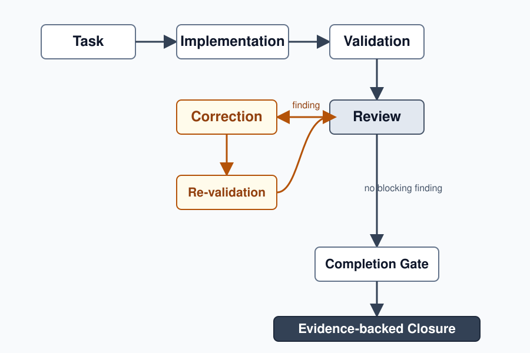

# AIWF

Repository-native, lightweight deterministic workflow governance for AI-assisted engineering.

## Why AIWF

AI-generated work can be useful before it is complete. A claim may be narrowed
by review, corrected, re-validated, or left bounded by an external dependency.
AIWF keeps those workflow decisions and their evidence visible in the
repository.

Git records how code changed. AIWF records the workflow evidence used to
validate, review, correct, and close the work.

## Optional MCP workflow interface

To use AIWF from Codex CLI, GitHub Copilot CLI or VS Code, install the optional adapter and point your client at the project that contains `./aiwf`. Start in read-only mode, call `aiwf_context` to verify the project, then list its tasks. The setup guide includes building from source, installing a wheel and enabling task creation. [MCP setup walkthrough (繁體中文)](.aiwf/docs/examples/mcp_setup.md)

Adapter 0.3.2 supports MCP `2026-07-28` and `2025-11-25` over the same local stdio command. The adapter reference covers tool inputs, permissions, operator review and client configuration examples. [Adapter reference (English)](integrations/mcp/README.md)

## Install

Use Python 3.10+ and a trusted local source package containing the executable
`aiwf` and its `.aiwf/` package. Use macOS or Linux for installation and
upgrade writes. On native Windows you can preview setup. Daily workflow writes
also require a supported local filesystem on macOS or Linux.
Run this command from the repository that should receive AIWF.

```bash
/path/to/aiwf-package/aiwf install --target . --yes
```

`--target` is the destination repository. Without `--yes`, AIWF performs the
same preflight and prints the plan without changing files. A complete or
partial installation is rejected; use the [Upgrade Guide](.aiwf/docs/upgrading.md)
for an existing AIWF repository.

### Install Payload Boundary

Public repository contents are not the install payload. Installation is limited
to the AIWF launcher and runtime-owned `.aiwf/` paths; repository-level
development assets such as `tests/`, `.github/`, root `docs/`, `knowledge/`,
release files, and review artifacts are intentionally excluded. Existing
project-owned `tests/`, `.github/`, and `docs/` directories are preserved
byte-for-byte.

## Quick start: verify your installation

This task checks whether your project's root `AGENTS.md` contains the installed
instruction block. In Bash, check that the installed Runtime can query this
worktree, then create the task once.

```bash
./aiwf query context && ./aiwf new-task verify_aiwf_install
```

Copy the complete dated path printed after `Task directory`. To resume in a
new terminal, run `./aiwf list` and find that task's full path. Paste it at
this prompt, even if another task has the same numeric ID on a different day.

```bash
read -r -p 'Paste the task directory: ' TASK
```

```bash
./aiwf guard --pre-edit --path "$TASK"
```

Once the guard passes, describe the expected managed block in the body of
`$TASK/task.md`. Keep its YAML header under AIWF's control. Run the actual
installation test below. Bash records a pass only if the test exits successfully.

```bash
./aiwf transition --path "$TASK" --to validation
./aiwf agents check --path AGENTS.md &&
  ./aiwf record --path "$TASK" --kind validation --result pass \
    --command './aiwf agents check --path AGENTS.md'
```

Write the observed result and any limitations in `self_validation.md`, describe
the work in `task_record.md`, and mark each acceptance criterion in the body
of `task.md` according to the evidence. If the test fails, record the failure
and its output. After agent review, send the task and its evidence to the
assigned human reviewer. Keep it open while awaiting their decision.

```bash
./aiwf check --path "$TASK"
./aiwf check --path "$TASK" --finalize-ready
```

The first check examines task structure. The second also checks closure
evidence, including completed review documents and the required review decision.
A new task can pass the first and remain blocked on the second. Once the
reviewer's actual decision has been recorded and readiness passes, run
`./aiwf finalize --path "$TASK"`. The [worked example](.aiwf/docs/examples/basic_lifecycle.md)
shows the review handoff, the failure path, and how to record closure.

### What does Finalize PASS mean?

AIWF Finalize PASS indicates that a task satisfied the applicable workflow
closure conditions based on its recorded evidence, including required
validation, review, and authority checks. It does not guarantee that original
requirements were fully understood or implemented, that validation coverage
was sufficient, or that the engineering result is correct. Engineering
correctness remains subject to appropriate validation, domain expertise, and
human judgment. See the [Workflow Protocol](.aiwf/docs/workflow_protocol.md#3-finalize-semantics)
for the evidence boundaries.

New tasks use structured review authority evidence. A task's
`required_review_authority` policy is checked against the review's
`decision_authority`; `recorded_by` identifies the actor that wrote the event
and may differ from the decision authority. This is deterministic workflow
evidence consistency, not authenticated human identity or cryptographic
approval. `doctor` and `report` additionally expose derived correction-loop,
projection, authority, and activity diagnostics without adding finalize gates.

## How AIWF Works

<p align="center">
  
</p>

AIWF provides task creation, deterministic checks, validation and review
evidence, correction tracking, and a completion gate. It does not execute the
engineering work or infer conclusions with an LLM.

## What AIWF Makes Visible

An ordinary engineering change can be represented as:

```text
Initial claim
    → Review finding
    → Correction
    → Re-validation
    → Evidence-backed Closure
```

The final Closure Summary is a short, human-authored conclusion aid:

```markdown
## Closure Summary
- Workflow Decision: finalize
- Engineering Outcome: bounded_incomplete
- Remaining Limitations: Real-DUT validation was not executed in this task.
- Follow-up: Real-DUT validation is tracked in task 052.
```

Workflow Decision and Engineering Outcome are different. `finalize` means the
current workflow has an explicit closure; it does not guarantee product
correctness. Closure Summary is not currently a finalize blocker.

## What AIWF Is

- A repository-native deterministic workflow governance layer.
- A place for local task, validation, review, and finalize evidence.
- A lightweight companion to AI-assisted engineering workflows.
- A tool that keeps workflow history inspectable without becoming the execution engine.

## What AIWF Is Not

- Not a prompt template or autonomous coding framework.
- Not a CI system or a replacement for Git.
- Not a DUT runner or domain validation system.
- Not a workflow orchestration engine.
- Not a tamper-proof audit ledger.
- Not a guarantee of correctness or reliability.
- Not a replacement for Human Review or accountable engineering judgment.

## Design Principles

### Evidence over claims

Completion claims should be supported by explicit workflow evidence.

### History is preserved

Workflow history should be extended rather than silently rewritten.

### Human authority remains explicit

AI assists engineering work but does not replace accountable human judgment.

### Deterministic before intelligent

Prefer deterministic governance rules before introducing model-dependent
reasoning.

## Project Status and Current Release

AIWF is under active development and is being evaluated through real engineering
workflow records. The version table describes this source tree. Use tagged
public releases for adoption. Tool and protocol versions evolve independently.

| Field | Value |
| --- | --- |
| Current Release | `1.7.17.post4` |
| Tool Version | `1.7.17.post4` |
| Workflow Protocol Version | `1.7.10` |
| Latest Release Notes | [v1.7.17.post4](.aiwf/docs/releases/v1.7.17.post4.md) |
| GitHub Releases | [jackden/aiwf releases](https://github.com/jackden/aiwf/releases) |

This tree pairs Core `1.7.17.post4` with adapter `0.3.2`. The `0.2.1`
adapter in the [post1 candidate notes](.aiwf/docs/releases/v1.7.17.post1.md)
was the pairing recorded for that earlier candidate.

## Documentation

- [Installation Guide](.aiwf/docs/adoption_guide.md)
- [MCP setup and first task (繁體中文)](.aiwf/docs/examples/mcp_setup.md)
- [Upgrade Guide](.aiwf/docs/upgrading.md)
- [CLI Reference](.aiwf/docs/cli_reference.md)
- [Evidence-linked Guidance](.aiwf/docs/guidance.md)
- [Workflow Protocol](.aiwf/docs/workflow_protocol.md)
- [Agent Rules](.aiwf/docs/agent_rules/00_index.md)
- [Reporting Guide](.aiwf/docs/reporting.md)
- [Security / Repository Boundary](.aiwf/docs/repo_boundary.md)
- [Release Notes](.aiwf/docs/releases/)

Post-finalization changes have two distinct paths: accidental artifact changes
use a dedicated repair workflow; a new fact or human-authorized correction is
recorded additively with `correct-finalized` and does not rewrite history. See
the [Workflow Protocol](.aiwf/docs/workflow_protocol.md) for the boundary.

## Contributing

See [CONTRIBUTING.md](CONTRIBUTING.md).

## Security

See [SECURITY.md](SECURITY.md).

## License

Apache License 2.0. See [LICENSE](LICENSE).
